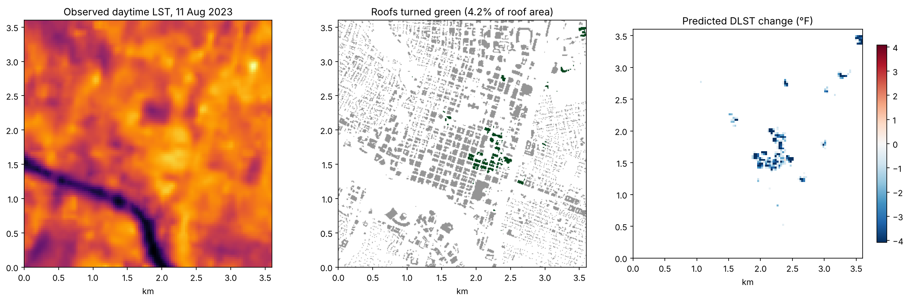

# green-roof-cooling-lidar

[](https://github.com/AbdullaKafy/green-roof-cooling-lidar/actions/workflows/ci.yml)
[](https://doi.org/10.1016/j.scs.2024.105893)
[](LICENSE)

**How much can green roofs cool a downtown? Lidar urban form, satellite heat and neural networks.**

Companion code for:

> Al Kafy, A., Crews, K. A., and Thompson, A. E. (2024). Exploring the cooling potential of green roofs for mitigating diurnal heat island intensity by utilizing Lidar and Artificial Neural Network. *Sustainable Cities and Society*, 116, 105893. https://doi.org/10.1016/j.scs.2024.105893

The paper built eight urban form layers for Austin City Council District 9 from
airborne lidar and Sentinel-2 (building height, roof area, building volume density,
sky view factor, solar radiation, NDVI, NDBI, distance to water). A neural network
learned how these explain daytime land surface temperature (DLST) from Landsat 8.
The network then predicted DLST again after 4.2% of roof area was given the surface
of a park lawn. Average DLST fell by 2.8 °F, with the most cooling on buildings 13 to
28 m tall.

The paper's results, tables and a key figure are in [`paper/`](paper). This
repository adds the method as a small, tested Python package and a worked example
on open data.

## Worked example: downtown Austin, 11 August 2023

[`examples/austin_downtown/`](examples/austin_downtown) runs the whole chain on a
3.6 km square of downtown Austin (inside District 9), with only open data:

* USGS 3DEP airborne lidar, 2 m (DSM, height above ground, building class), through the Microsoft Planetary Computer
* Landsat 8 Collection 2 Level-2 surface temperature, 11 August 2023 (the paper's scene)
* Sentinel-2 Level-2A, 12 August 2023 (the paper's date)



| | Paper (District 9) | This example (3.6 km downtown square) |
|---|---|---|
| Model | MATLAB network, 95 and 10 hidden neurons, best of 11 training algorithms (trainbfg) | scikit-learn network, 95 and 10 hidden neurons, best of 4 optimizers (lbfgs, like trainbfg) |
| Validation | Random 80/20 split, 15 folds: R² 0.757, RMSE 0.902 °F | Spatial blocks of 300 m, 5 folds: R² 0.60, RMSE 3.87 °F |
| Roofs turned green | 4.2% of roof area, picked by eye on hot spots | 4.2% of roof area, hottest roofs first (rule-based) |
| Cells that changed | 355 (263 cooled by 3 to 7 °F) | 263 (262 cooled) |
| Mean DLST change | -2.8 °F (range -7 to +0.25 °F) | -2.7 °F (range -12.9 to +0.8 °F) |
| Cooling by building height | Largest for 13 to 28 m | -2.4 °F (under 13 m), -3.4 °F (13 to 28 m), -5.0 °F (28 to 50 m) |
| Most needed inputs (leave one out) | NDVI, distance to water, NDBI | Solar radiation, distance to water, NDBI |

The mean cooling is close to the paper's, but read it with care:

1. **Different validation.** Spatial blocks hold out whole neighborhoods, so R² is
   lower than with a random split. This is the stricter test.
2. **Different temperature product.** Collection 2 surface temperature gives
   93 to 138 °F for this scene; the paper's own DLST steps gave 78 to 108 °F.
3. **Different lidar.** USGS 3DEP (Texas Central, 2017 to 2019) instead of the 2021
   TNRIS collection, so buildings finished after 2019 are missing.
4. **Solar radiation.** The paper used ArcGIS Area Solar Radiation. Here
   `morphology.daily_direct_insolation` sums clear-sky direct sun with building
   shade over the day. It leaves out diffuse light, and it ranks first in the
   leave-one-out test, unlike in the paper.
5. **Rooftop choice.** The paper picked roofs by eye. Here a rule picks the
   hottest roofs first, so the choice can be repeated and changed.

## Package

| Module | What it does |
|---|---|
| `data` | 3DEP lidar, Landsat 8 surface temperature and Sentinel-2 on three aligned grids (2, 10 and 30 m) |
| `lidar` | nDSM, building mask and ids, building height, roof area index (BRI), volume density (BVD), block aggregation |
| `morphology` | Sky view factor, cast shadow, sun position, daily direct insolation, distance to water |
| `indices` | NDVI, NDBI, MNDWI |
| `model` | Compare neural networks with spatial block cross-validation, leave-one-out input test |
| `simulate` | Pick roofs, apply green roof surface values, summarize cooling |

```python
from greenroof import lidar, morphology, model, simulate

h = lidar.ndsm(dsm, dtm)                                   # height above ground
svf = morphology.sky_view_factor(dsm, pixel_m=2, radius_m=90, directions=16)
scores = model.compare_networks(X, y, groups)              # spatial block CV
roofs = simulate.select_rooftops(roof_ids, dlst_10m, target_share=0.042)
ndvi_g, ndbi_g = simulate.green_roof_scenario(ndvi_10m, ndbi_10m, roofs)
```

## Run it

```bash
git clone https://github.com/AbdullaKafy/green-roof-cooling-lidar.git
cd green-roof-cooling-lidar
pip install -e ".[dev]"
cd examples/austin_downtown
jupyter lab workflow.ipynb      # about 15 minutes, mostly network fitting
```

The model tables (about 2 MB) are included. To rebuild them from the raw data
(about 1 minute to download, no account needed):

```bash
pip install -e "../..[download]"
python download.py    # raw lidar, Landsat and Sentinel-2 layers (not stored in git)
python prepare.py     # 30 m model table and 10 m roof layer
```

A quick synthetic demo of the paper's steps runs in seconds: `python paper/sample.py`.

## Tests

```bash
pytest -q
ruff check .
```

## Data credits

Lidar: U.S. Geological Survey 3D Elevation Program (public domain). Landsat data
courtesy of the U.S. Geological Survey. Sentinel-2: contains modified Copernicus
Sentinel data (2023). All accessed through the Microsoft Planetary Computer.

## License

Code: MIT. The paper is © Elsevier; the figure in `paper/` is shown by its author
for reference.
