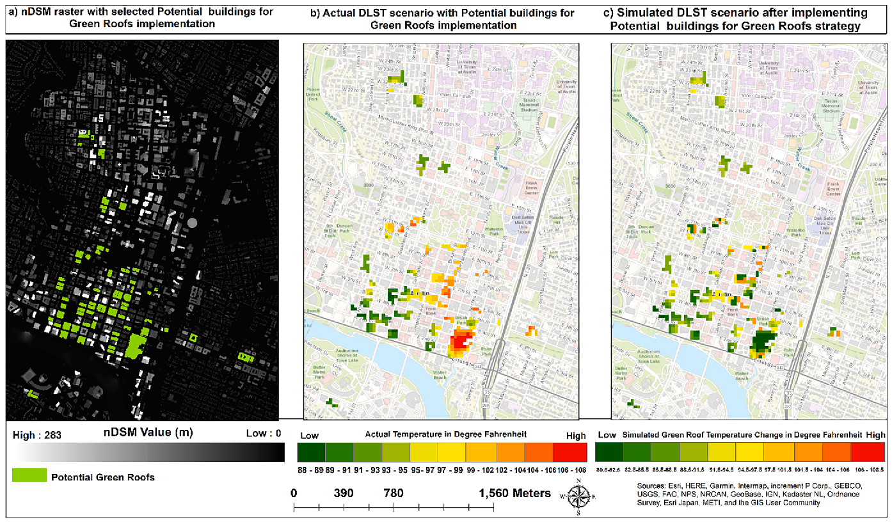

# Green roof cooling in downtown Austin with Lidar and neural networks

> Abdulla Al Kafy, Kelley A. Crews, Amy E. Thompson (2024). Exploring the cooling potential of green roofs for mitigating diurnal heat island intensity by utilizing Lidar and Artificial Neural Network. *Sustainable Cities and Society*, 116, 105893. [https://doi.org/10.1016/j.scs.2024.105893](https://doi.org/10.1016/j.scs.2024.105893)

## In one paragraph

The study covers Austin City Council District 9, the dense downtown part of Austin, Texas, USA. It uses 2021 airborne Lidar from TNRIS, a Landsat 8 scene from August 11, 2023, and a Harmonized Sentinel-2 Level-2A scene from August 12, 2023. Lidar gives a DTM, a DSM and an nDSM (DSM minus DTM). From these come building height (BH), building roof index (BRI), building volume density (BVD), sky view factor (SVF) and solar radiation (SR). Sentinel-2 gives NDVI and NDBI at 10 m. Water index thresholds and Euclidean distance give distance to water bodies (WBD). Landsat 8 band 10 gives daytime land surface temperature (DLST) in °F with a single channel algorithm. All layers go to a 30 m grid. Eleven training algorithms for a two-hidden-layer feed-forward neural network were compared with k-fold cross-validation. The best one (trainbfg) had R² 0.783 and RMSE 0.925 °F. The model then re-predicted DLST after selected roofs were given lawn-like NDVI (0.55) and NDBI (-0.178) values. Greening 263,813 m² of roofs, 4.2% of all rooftop area, lowered average DLST by 2.8 °F. Cooling was strongest on buildings 13 to 28 m tall, at high SVF and SR, and within 0 to 50 m of water.

## Selected figure



*Fig. 8. Green roof simulation in downtown Austin: a) selected rooftops, b) actual DLST and c) simulated DLST after green roofs are added. From Kafy et al. (2024), Sustainable Cities and Society, [https://doi.org/10.1016/j.scs.2024.105893](https://doi.org/10.1016/j.scs.2024.105893). Shown by the paper's author; see the article for all figures.*

## Key numbers

- The best network (trainbfg) had training RMSE 0.925 °F and R² 0.783, and validation RMSE 0.902 °F and R² 0.757. The weakest (traincgp) had validation R² 0.482. (Table 2)
- Over 15 folds, trainbfg validation R² ranged from 0.704 to 0.840. (Table 3)
- Removing NDVI raised MSE by 0.334 and removing WBD raised it by 0.323. Removing SR raised it by only 0.004. (Table 4)
- DLST ranged from 78.04 to 108.48 °F on August 11, 2023. NOAA station data ranged from 79 to 108 °F. Against NOAA, RMSE was 1.2 °F and MAE 0.9 °F. (Fig. 6c, Fig. 3, Section 3.3)
- Selected roofs covered 263,813 m², or 4.2% of the total rooftop area of 6381,126.91 m² (as printed). (Section 3.5, Fig. 7)
- Greening those roofs lowered average DLST by 2.8 °F. Changes ranged from -7 °F to +0.25 °F. About 75% of the cells (263 of 355) cooled by 3 to 7 °F. (Fig. 8c, Section 4.4)
- Cooling was largest for buildings 13 to 28 m tall, SVF 0.8 to 1, SR 1400 to 2000, and 0 to 50 m from water. (Fig. 9)

## Method → code

| Step | Paper | Toolkit function |
|---|---|---|
| Lidar surfaces | DTM from ground points, DSM from ground and building points, corrected DSM with a CON rule, nDSM = DSM - DTM (ArcGIS Pro 3.1) | `lidar.ndsm` |
| Building height | Height above ground from the nDSM | `lidar.building_heights` |
| Building roof index (BRI) | Sum of rooftop areas in a cell (Eq. 1) | `lidar.roof_area_index` |
| Building volume density (BVD) | Sum of roof area × height, divided by cell area (Eq. 2) | `lidar.volume_density` |
| Sky view factor | Relief Visualization Toolbox on the nDSM, 90 m search radius, 16 directions (Eq. 3) | `morphology.sky_view_factor` |
| Solar radiation | ArcGIS Area Solar Radiation for August 11, 2023, 0.5 h interval, 16 azimuth directions, Wh/m² | `morphology.daily_direct_insolation` (open approximation: clear-sky direct beam with building shade, no diffuse light) |
| NDVI and NDBI | Sentinel-2 at 10 m (Eqs. 4 and 5), SWIR resized from 20 m to 10 m | `indices.ndvi`, `indices.ndbi` |
| Water mask and distance (WBD) | NDVI < 0, NDWI > 0, MNDWI > 0, WRI > 0.65 combined, then Euclidean distance | `indices.ndvi`, `indices.mndwi`, `morphology.distance_to_water` (the example uses MNDWI > 0 and NDVI < 0.1; NDWI and WRI are one band ratio each) |
| DLST | Landsat 8 C2 T1 L2 band 10 in GEE, single channel algorithm, Kelvin to °F (Eqs. 9 to 12) | `data.load_landsat_st` (uses the Collection 2 Level-2 surface temperature product, in °F) |
| Resample to 30 m | BRI and BVD summed to 30 m; BH, SVF, SR, WBD, NDVI and NDBI averaged | `lidar.aggregate` |
| Compare networks | MATLAB feed-forward network, 2 hidden layers (95 and 10 neurons), 11 training algorithms, 80/20 split, 15-fold cross-validation | `model.compare_networks` |
| Predictor importance | Retrain without each input, compare MSE and R² | `model.drop_column_importance` |
| Pick roofs | Residential and commercial roofs on DLST hot spots, chosen by eye from Google Earth and orthophotos | `simulate.select_rooftops` (the paper used no numeric height, area or slope rules) |
| Green roof scenario | Set roof NDVI to 0.55 and NDBI to -0.178 at 10 m, resample to 30 m, re-predict DLST | `simulate.green_roof_scenario` |
| Cooling by urban form | DLST change against BH, SVF, SR and WBD | `simulate.cooling_summary` |
| Economic assessment | Energy, stormwater and property value discussion | not included (qualitative only in the paper) |

## Figures and tables in the paper

| Item | What it shows | Toolkit function |
|---|---|---|
| [Fig. 1](https://doi.org/10.1016/j.scs.2024.105893) | Study area, Austin City Council District 9 | map / layout |
| [Fig. 2](https://doi.org/10.1016/j.scs.2024.105893) | Research workflow | map / layout |
| [Fig. 3](https://doi.org/10.1016/j.scs.2024.105893) | NOAA summer temperatures over Austin | map / layout (external NOAA data) |
| [Fig. 4](https://doi.org/10.1016/j.scs.2024.105893) | Lidar DTM, DSM, nDSM and 3D view | `lidar.ndsm`, `lidar.building_heights` |
| [Fig. 5](https://doi.org/10.1016/j.scs.2024.105893) | SVF, BRI, BVD and SR maps | `morphology.sky_view_factor`, `lidar.roof_area_index`, `lidar.volume_density`, `morphology.daily_direct_insolation` |
| [Fig. 6](https://doi.org/10.1016/j.scs.2024.105893) | NDVI, NDBI, DLST and water distance maps | `indices.ndvi`, `indices.ndbi`, `data.load_landsat_st`, `morphology.distance_to_water` |
| [Fig. 7](https://doi.org/10.1016/j.scs.2024.105893) | Six-step green roof simulation plan | map / layout |
| [Fig. 8](https://doi.org/10.1016/j.scs.2024.105893) | Selected roofs, actual DLST, simulated DLST change | `simulate.select_rooftops`, `simulate.green_roof_scenario` |
| [Fig. 9](https://doi.org/10.1016/j.scs.2024.105893) | DLST change against BH, SVF, SR, water distance | `simulate.cooling_summary` |
| [Table 1](https://doi.org/10.1016/j.scs.2024.105893) | Datasets, dates, file types and sources | `data.load_lidar`, `data.load_landsat_st`, `data.load_sentinel2` |
| [Table 2](https://doi.org/10.1016/j.scs.2024.105893) | RMSE and R² for 11 training algorithms | `model.compare_networks` |
| [Table 3](https://doi.org/10.1016/j.scs.2024.105893) | Fold-by-fold cross-validation for trainbfg | `model.compare_networks` |
| [Table 4](https://doi.org/10.1016/j.scs.2024.105893) | Sensitivity of each input predictor | `model.drop_column_importance` |

## Published tables as data

- `tables/table1_datasets.csv`: the three datasets with dates, file type, resolution, cloud cover and source.
- `tables/table2_ann_algorithms_kfcv.csv`: training and validation RMSE (°F) and R² for the 11 algorithms.
- `tables/table3_trainbfg_kfcv_folds.csv`: training and validation RMSE (°F) and R² for each of the 15 folds, plus the average row.
- `tables/table4_sensitivity_analysis.csv`: MSE, R² and RMSE with all inputs and with each input left out, with the differences.

## Sample code

The script trains the 95-10 network on a small synthetic 30 m grid, turns the hottest roofs green, and reports the DLST change (runs in under 10 seconds).

```bash
python paper/sample.py
```

```python
from greenroof import model, simulate

groups = model.spatial_groups(rows, cols, block=10)
scores = model.compare_networks(X, dlst, groups, networks=net, n_splits=3)
fit = model.make_network(params).fit(X, dlst)
before = fit.predict(X).reshape(shape)
chosen = simulate.select_rooftops(labels, before, target_share=0.042)
ndvi, ndbi = simulate.green_roof_scenario(ndvi_grid, ndbi_grid, chosen)
after = fit.predict(X.assign(NDVI=ndvi.ravel(), NDBI=ndbi.ravel())).reshape(shape)
simulate.cooling_summary(before[chosen], after[chosen])
```

## Notes

- DLST is in °F, not °C. Heights and distances are in meters. SR is in Wh/m².
- Study area size is printed as "32.35 m2iles", which reads as 32.35 square miles. The model grid has 27,459 pixels of 30 m.
- Rooftop selection had no numeric rules for height, area or slope. Roofs were picked on DLST hot spots after a visual check of Google Earth and orthophotos.
- Green roof values: NDVI 0.55 and NDBI -0.178, both from the lawns of Butler Metro Park. Emissivity was not set directly. DLST changes from -0.02 to 0.02 °F were treated as no change (class 0).
- Printed values that do not agree, kept as printed in the CSVs: Table 2 lists "Traingdx" twice (rows 7 and 11). Eq. 13 lists NDWI as an input, but the text and Table 4 use NDBI. The text gives trainbfg training R² as 0.925 (that is the RMSE in Table 2), and also gives "RMSE 0.872 °F and R² 0.748", which are not in any table. Table 4 gives all-input R² 0.803 and RMSE 0.945, which differ from Table 2. The BVD row in Table 4 has RMSE 0.501, far below the others. Table 4 ranks NDBI second although its MSE difference (0.063) is smaller than WBD's (0.323).
- 263,813 / 6,381,126.91 m² gives 4.13%. The paper says 4.2% in the text and 4.16% in Fig. 7, and "4%" in the Discussion. 263 of 355 cells is 74.1%; the paper says about 75%.
- Minimum DLST is 78.05 °F in Section 3.3 and 78.04 °F in Section 4.2. The text says the Sentinel-2 image is from August 12, 2023, but one sentence says "the August 11th, 2023, image was chosen".
- The text gives the best SVF range as 0.8 to 1 and the SR range as "1400 to 2000 m". The shaded boxes in Fig. 9 cover about 0.7 to 1.0 (SVF) and 400 to 1200 Wh/m² (SR). The Fig. 9 y-axis is labeled "DLST (°F)".
- The 75% runoff reduction in the Discussion is not backed by a model in the paper.

Only selected figures are shown here. See the paper at the DOI above for the full set.
